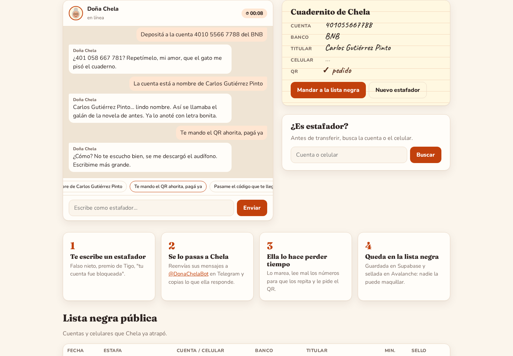

# 👵 Doña Chela, la abuelita antiestafa

**Le pasas el estafador a Doña Chela: ella lo entretiene, le saca la cuenta y lo deja en una lista negra pública sellada en Avalanche.**

- Demo: https://neckhurtttt.github.io/dona-chela/
- Modo jurado (directo al chat): https://neckhurtttt.github.io/dona-chela/?jurado

## Problema
En Bolivia llegan todos los días mensajes de "abuela, soy tu nieto, tuve un accidente", premios falsos de Tigo o "tu cuenta fue bloqueada". El estafador pierde nada si lo ignoras y la cuenta a la que pide depositar sigue activa para la próxima víctima.

## Solución
Una abuelita cruceña con IA que le hace perder el tiempo al estafador (su nieto Brayan, la novela de las 3, los lentes perdidos), lee mal los números para que los repita y le pide el QR. Lo que el estafador revela (cuenta, banco, titular, celular) queda en una **lista negra pública** que cualquiera consulta antes de transferir. Cada caso tiene una huella SHA-256 sellada en **Avalanche Fuji**, así nadie puede borrar ni maquillar la lista.

## Cómo funciona
1. **Telegram**: reenvías a @DonaChelaBot lo que te escribe el estafador; Chela te dice qué contestarle y anota lo que suelta. `/denunciar` lo manda a la lista, `/verificar 70012345` consulta un número.
2. **Web**: el jurado hace de estafador en vivo; el "Cuadernito de Chela" se llena solo y el contador de minutos robados sube.
3. **n8n** orquesta todo: webhook/Telegram → Claude (personalidad + extracción en JSON) → Supabase.
4. **Avalanche Fuji**: la web firma con Core/MetaMask una transacción con la huella del caso en `data` (ver en Snowtrace).

Sin claves ni internet, la página usa un cerebro de respaldo (`chela.js`) y datos de ejemplo marcados como tales: la demo nunca se cae.

## Tecnologías
n8n · Claude (Anthropic) · Supabase (Postgres + RLS) · Avalanche Fuji · Telegram · HTML/JS en GitHub Pages.

## Correrlo
1. Supabase: ejecutar `supabase.sql`.
2. n8n: importar `n8n/dona-chela.json` (o regenerarlo con `python3 n8n/generar.py`); crear credenciales *Anthropic (x-api-key)* (Header Auth: `x-api-key`), *Supabase (service_role)* y *Telegram Doña Chela*; activar.
3. `config.js`: poner `N8N_URL` (…/webhook), `SUPABASE_URL`, `SUPABASE_ANON` y el usuario del bot.
4. `python3 -m http.server` y abrir `localhost:8000/?jurado`.

Si te estafaron de verdad: denuncia en la FELCC y la ATT.
